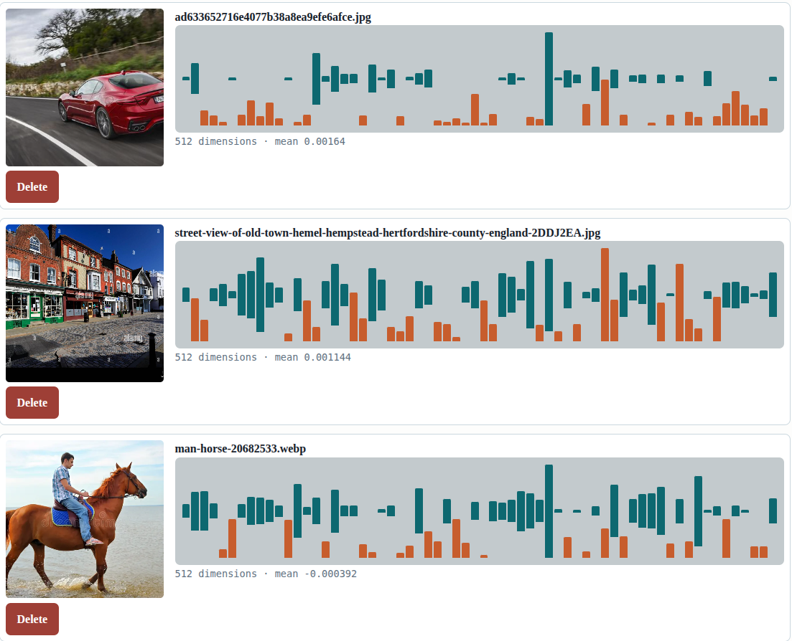
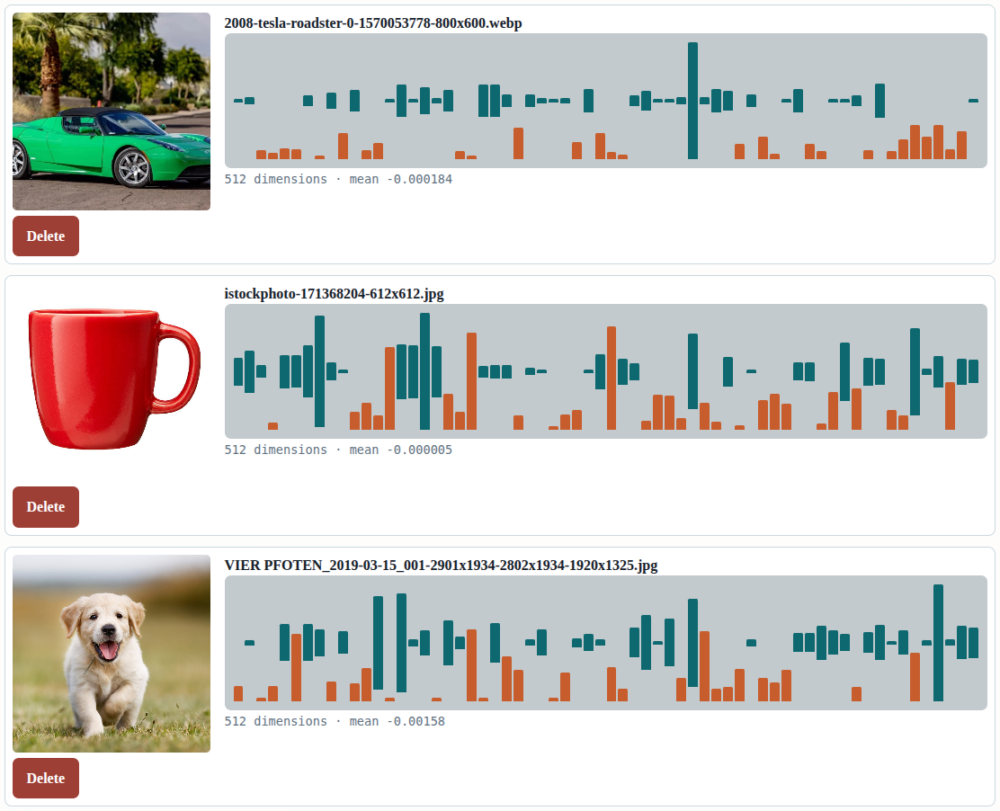
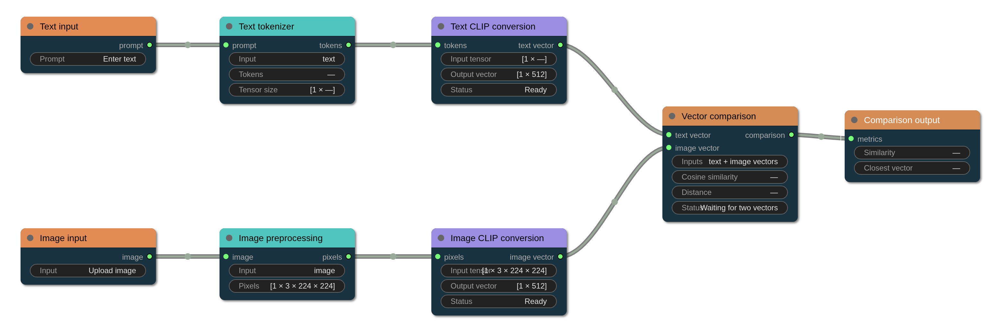
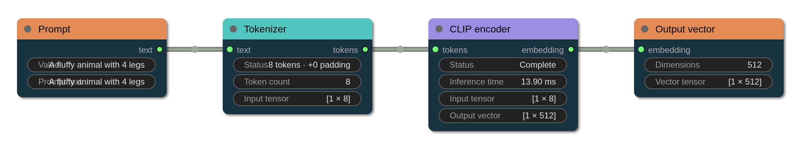
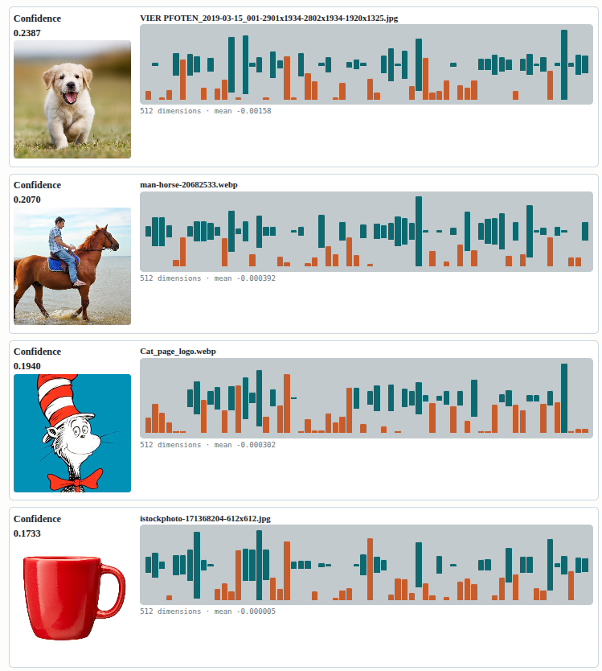
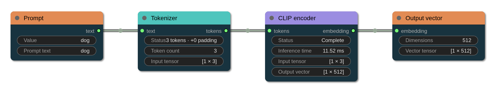
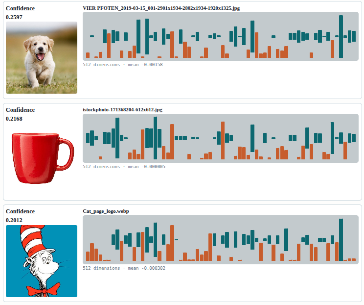
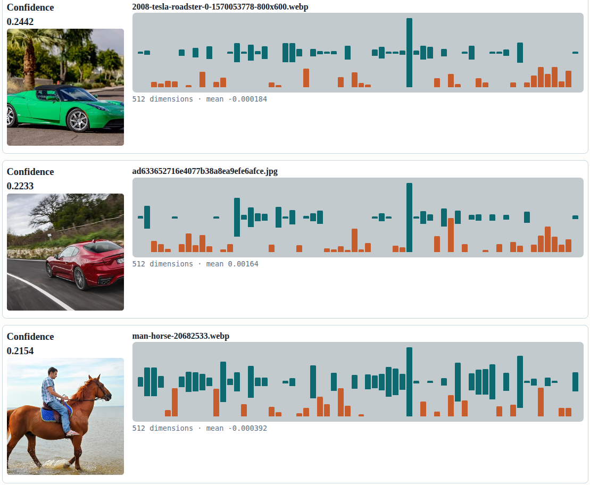

# CLIP Toy

A local CLIP image and text vector explorer. It uses `openai/clip-vit-base-patch32` by default, stores uploaded images and normalized vectors under `data_cash/`, and searches images with cosine similarity.

## Run

```bash
pip install -r requirements.txt --break-system-packages
python server.py
```

Open http://127.0.0.1:8000/.

Startup loads the cached CLIP weights once before serving the page. This can take several seconds on CPU, but the first text or image request will not pause while loading the model.

The first embedding request downloads the model from Hugging Face and may require network access. Model files are stored in `data_cash/model_cache/` and reused on later runs. Once the local snapshot is complete, the server automatically uses it without Hugging Face metadata requests. Set `CLIP_OFFLINE=1` to force offline mode, or set `CLIP_MODEL` to use another compatible CLIP checkpoint. `CLIP_PORT` changes the port.

## Pages

- `/` uploads images, creates vectors, and visualizes the cached image vectors.
- `/text` embeds a prompt, visualizes its vector, finds similar cached images, and shows `Prompt -> Tokenizer -> CLIP -> Output` in LiteGraph.
- `/graph` shows the image and text branches feeding the shared CLIP embedding space.
- `/api/health` reports model and cache status.

Each upload has an image file, a NumPy vector file, and an entry in `data_cash/index.json`. Set `CLIP_DATA_DIR` to use another storage directory.

## Notes

This is intentionally a small single-process local tool. It does not include authentication, image generation, or a separate vector database. The browser loads LiteGraph from jsDelivr, so graph pages need network access for that script unless it is vendored locally.


## Clip

In a CLIP-based text-to-vector (or text-to-3D/latent generation) model, the output is typically described as a multidimensional embedding vector or a continuous latent space coordinate that aligns the semantic meaning of the text prompt with a shared joint representation space.

Here is a breakdown of how that output is characterized structurally and functionally:

Dimensional Vector: The output is a dense, fixed-size numerical array (e.g., a 512-dimensional or 768-dimensional vector, depending on the specific CLIP architecture like ViT-B/32 or ViT-L/14).

Normalized Embedding: The vector is almost always L2-normalized (
∣∣v∣∣ 
2
​
 =1). This places all text and image concepts onto a unit hypersphere, making cosine similarity equivalent to a simple dot product.

Semantic Coordinate: Rather than containing pixels or voxels directly, the output acts as a coordinate or "semantic anchor" in a shared latent space. Because CLIP was trained via contrastive learning to align images and text, a text prompt's output vector sits close to the vectors of images that visually depict that same concept.

How the Output is Used downstream
Optimization Target (e.g., CLIP-guided generation/StylGAN/NeRFs): In optimization-based text-to-3D or text-to-vector pipelines, the model doesn't generate a final asset in a single forward pass. Instead, the text prompt is passed through the CLIP text encoder to produce a target vector (
v 
text
​
 ). The generator then creates candidate outputs (images, meshes, or neural fields), passes them through the CLIP image encoder to get 
v 
image
​
 , and calculates the cosine distance (or loss) against 
v 
text
​
  to iteratively guide the gradient updates.

Latent Space Conditioning: In diffusion or latent-space mapping models, the text embedding serves as a conditioning signal (via cross-attention or vector conditioning) to steer a generator toward the desired semantic region.


## visualisation of multidimensional embedding vector

shows just first 64 valuies of 512









A fluffy animal with 4 legs






# dog






# dog (full 77 pad)


# things with wheels





242 Mb od weighs in this onnx sidecar file

